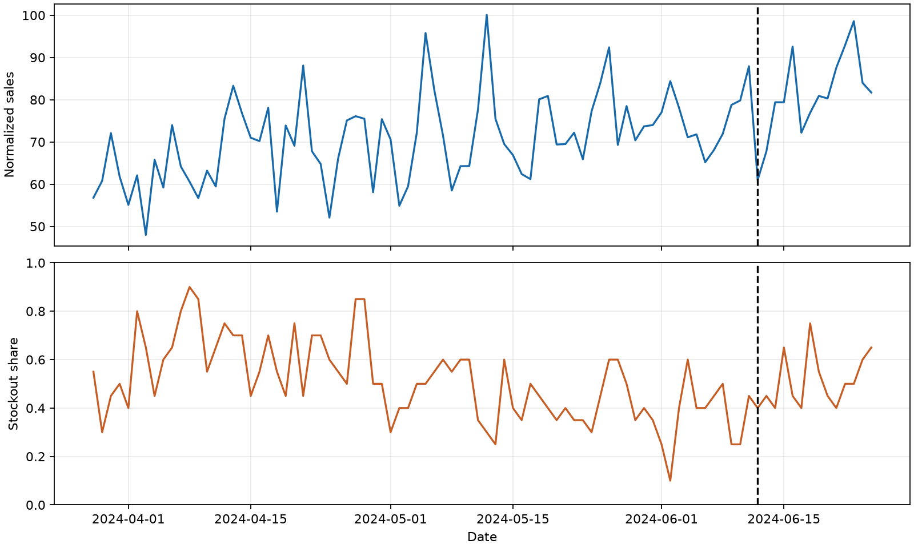

# Fresh retail sales forecasting

A reproducible supply-chain analytics case study using SQL, Python and the FreshRetailNet-50K dataset. The objective is **next-day observed sales forecasting**, with daily updates, for 20 products in one store.

## Results

| Method | Internal validation WAPE | Official test WAPE | Test MAE |
|---|---:|---:|---:|
| Previous 7-day mean | 20.7% | 27.3% | 1.089 |
| 7-day mean × weekday factor | 20.5% | 25.0% | 0.995 |

The test contains 140 store-product-days (20 products × 7 days). The weekday factor is estimated using the internal training period and fixed before test evaluation. Predictions are updated daily with observed sales from previous days, including previous test days. This is not a single 7-day forecast made at the start of the week.



## Approach

1. Inspect Parquet schema and audit missing values, duplicate keys and stockouts with PyArrow and DuckDB SQL.
2. Select store 18 and 20 products using data before the validation period. Split training through 2024-06-11 and internal validation from 2024-06-12 to 2024-06-25.
3. Compare last-weekday, 3-day and 7-day moving-average baselines. Explore weekday and stockout differences; choose a weekday-adjusted 7-day average based on validation.
4. Evaluate the fixed method on the official held-out dates 2024-06-26 to 2024-07-02. Report WAPE = sum of absolute errors / sum of absolute observed sales, MAE and signed bias.

## Reproduce

Use Python 3.12. The tested package versions are in `requirements.txt`.

```bash
python -m venv .venv
# Windows PowerShell: .\.venv\Scripts\Activate.ps1
# macOS / Linux: source .venv/bin/activate
python -m pip install -r requirements.txt
```

Download [train.parquet](https://huggingface.co/datasets/Dingdong-Inc/FreshRetailNet-50K/resolve/main/data/train.parquet) and [eval.parquet](https://huggingface.co/datasets/Dingdong-Inc/FreshRetailNet-50K/resolve/main/data/eval.parquet) into a `data/` directory at the repository root, then run:

```bash
python run_pipeline.py
```

Scripts are numbered and can also be run individually, for example `python scripts/07_weekday_analysis.py`. They depend on outputs from earlier scripts; running the full pipeline in order generates files in `artifacts/`. `results/` contains the checked-in aggregate results and chart from the original run. For an existing download elsewhere, set `FRESH_RETAIL_TRAIN` to the path to `train.parquet`; `eval.parquet` must be in the same directory.

## Interpretation and limitations

Sales are globally normalized observed sales, not physical units or true unconstrained demand. Stockouts may censor demand. Differences between stockout groups are descriptive, not causal. The sample is one store and 20 high-selling products, and the final test covers only seven days. Validation was used for model selection; the test has now been inspected and must not be reused to tune models. Next steps include rolling time validation, broader store/product coverage and inventory optimization only when unit, cost and lead-time information is available.

## Data attribution

Dataset: Dingdong Inc., [FreshRetailNet-50K](https://huggingface.co/datasets/Dingdong-Inc/FreshRetailNet-50K), released under [CC BY 4.0](https://creativecommons.org/licenses/by/4.0/). Related [paper](https://arxiv.org/abs/2505.16319). Original datasets are downloaded separately and are not committed to this repository.
